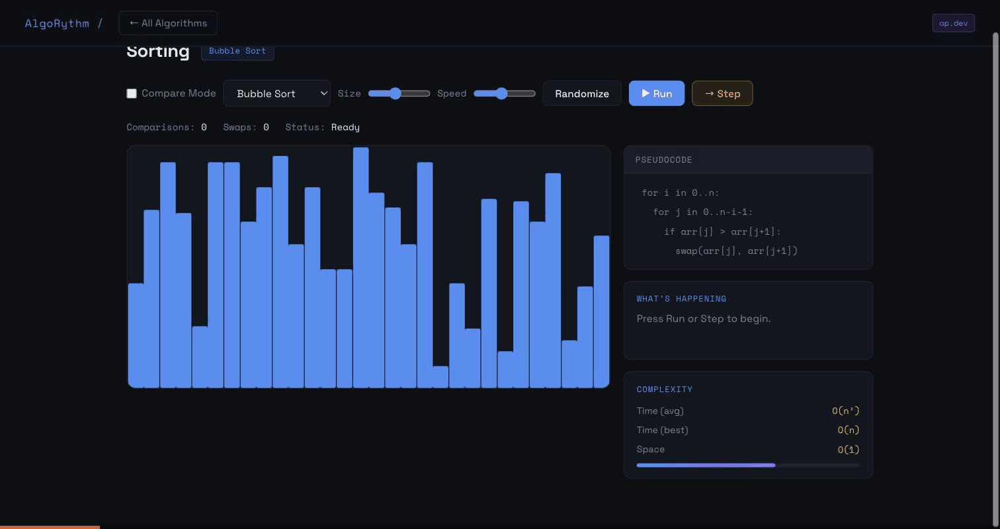

# AlgoRythm 🎵

> A zero-dependency, offline-ready algorithm teaching tool that runs from a single HTML file.

[](https://abhiyuday18.github.io/algorythm)
[](https://github.com/Abhiyuday18/algorythm/actions/workflows/test.yml)


---

- **No install** - there is nothing to `npm install`
- **No login** - open it and start using it
- **No backend** - no server, no database, no API keys
- **No npm** - no `node_modules`, no lockfiles, no build pipeline
- **Works offline** - download the file once, use it anywhere, forever
- **Easy for teachers to share** - one file, drop it in a shared folder, done
- **Easy for students to open** - double-click, no setup instructions needed
- **Hostable anywhere** - GitHub Pages, a USB stick, a school intranet, a static file server
- **Perfect for classrooms and labs** - runs on locked-down machines with no admin rights

---



*Compare Mode racing Quick Sort against Bubble Sort on the same array, ending with an auto-generated summary of who finished first, the operation counts, and why.*

---

## What is AlgoRythm?

AlgoRythm is a browser-based algorithm visualizer designed for learners and educators. Every algorithm can be run automatically or stepped through one move at a time, with live pseudocode highlighting and plain-English explanations at each step.

Built entirely in vanilla HTML, CSS, and JavaScript. Zero dependencies, zero frameworks.

---

## Algorithms Covered

| Category | Algorithms |
|----------|-----------|
| **Sorting** | Bubble Sort, Selection Sort, Insertion Sort, Merge Sort, Quick Sort |
| **Searching** | Binary Search |
| **Pathfinding** | BFS (Breadth-First Search), DFS (Depth-First Search), Dijkstra's Algorithm (weighted) |
| **Recursion** | Towers of Hanoi |
| **Backtracking** | N-Queen Problem, Sudoku Solver |

---

## Features

- **Step-by-step mode**: press `→ Step` on any algorithm to advance one operation at a time, at your own pace
- **Auto-run mode**: watch the full animation with adjustable speed control
- **Live pseudocode**: the current line highlights as the algorithm executes
- **Plain-English explanations**: every step is explained in a sidebar panel in simple language
- **Complexity breakdown**: time and space complexity shown for each algorithm with a visual bar
- **Compare Mode**: race any two sorting algorithms side by side on the same array, with an auto-generated summary of who won and why
- **Benchmark Mode**: measure all five sorting algorithms across doubling array sizes and plot the real operation counts, making the O(n&#178;) vs O(n log n) divergence visible as data, not just notation. Choose the input pattern (random, nearly sorted, reversed, few unique values) and the metric (total ops, comparisons, or swaps), and the explanation below the chart is rebuilt from the measured numbers, including catching Quick Sort's last-element pivot degrading on ordered input
- **Challenge Mode**: predict-before-reveal quizzing for sorting. The animation pauses mid-run with the compared elements highlighted and asks what happens next ("will they swap?", "which value is taken?", "which side of the pivot?") before revealing the outcome, with score and streak tracking. Every question is answerable by reading the current state, which turns passive watching into retrieval practice
- **Quick-check quizzes**: when any algorithm finishes (a full Run, or the last click in Step mode) a multiple-choice card appears below the visualizer with a question specific to what you just watched, such as why BFS cannot find the optimal path on Dijkstra's weighted grid. Correct and wrong answers are marked green and red with a one-line explanation, and the card resets on the next run
- **Custom array input**: type your own numbers (`5, 3, 8, 1, 9`) and run any sorting mode on your data. Non-numbers are ignored, values are kept within 1-100, and empty or invalid input shows an inline error
- **Interactive controls**: adjust array size, board size, disk count, speed, and more
- **Pathfinder grid**: draw walls, set start and end points, then watch BFS, DFS, or Dijkstra navigate
- **Zero install**: runs entirely in the browser, no setup required
- **Keyboard accessible**: every card, control, and the pathfinder grid itself work without a mouse; live regions announce step-by-step narration to screen readers
- **Adaptive light/dark theme**: follows your OS preference by default, with a manual toggle that remembers your choice
- **Guided tour and Docs**: a skippable first-visit tour of the main features, and an in-app Docs page covering every mode, shortcut, and how it works under the hood

---

## How to Use

1. Visit [abhiyuday18.github.io/algorythm](https://abhiyuday18.github.io/algorythm)
2. Pick an algorithm from the dashboard
3. Press **▶ Run** for the full animation, or **→ Step** to go one step at a time
4. Watch the pseudocode panel highlight the current operation
5. Read the explanation panel to understand what's happening at each step

> **Tip:** There's a hidden easter egg. Try typing something on the keyboard.

---

## Tech Stack

- **HTML5**: structure and layout
- **CSS3**: dark theme, animations, responsive grid
- **Vanilla JavaScript**: all algorithm logic, canvas rendering, step generators
- **Canvas API**: sorting bars and Towers of Hanoi animation
- **CSS Grid**: pathfinder and N-Queen boards
- **Google Fonts**: Space Grotesk + Space Mono

No libraries. No frameworks. No build tools.

---

## Why Single-File?

AlgoRythm is intentionally built as a self-contained HTML application so it can be used in classrooms, coding clubs, workshops, and low-setup environments without requiring Node.js, package managers, build tools, or internet access.

This is a deliberate trade-off, not a shortcut:

| Typical web app | AlgoRythm |
|---|---|
| `npm install` before first run | Double-click and go |
| Needs a dev server or deploy pipeline | Opens directly from disk or any static host |
| Breaks without internet (CDNs, APIs) | Fully functional offline once downloaded |
| Assumes admin rights to install tooling | Works on locked-down school/lab machines |

The cost of that trade-off is a larger single file instead of a modular codebase - a deliberate choice given the target environment (classrooms and self-paced learners), not an oversight. See [ARCHITECTURE.md](ARCHITECTURE.md) for how that single file is organized internally, including the generator-based pattern that drives both Run and Step modes.

---

## Accessibility

A teaching tool that only works for mouse users excludes exactly the classroom and self-paced-learner audience it's built for, so this got a real pass rather than a checkbox:

- **Nothing requires a mouse.** Every algorithm card, nav control, form control, and the pathfinder grid itself are reachable by Tab and operable with Enter/Space, including a "Skip to main content" link for keyboard users to bypass the nav.
- **The pathfinder grid has a real keyboard interface**, not just a workaround. Arrow keys move a cursor cell (shown with a visible focus ring), Enter/Space applies whatever mode is selected (draw wall, set start, set end), and a screen-reader-only live region announces the cursor's row, column, and cell state on every move. The 476 individual grid cells are marked `aria-hidden`, since the interaction is exposed through the focusable container and the announcement, not per-cell.
- **The core "teach as it runs" narration reaches screen readers.** The plain-English explanation panel and every status indicator use `aria-live="polite"`, so step-by-step narration is announced automatically, not just rendered visually.
- **Decorative visuals stay out of the accessibility tree.** The canvas-rendered bar charts and mini-previews are `aria-hidden`, since the same information is already available as text (stat counters, the explanation panel).
- **`prefers-reduced-motion` is respected**: transitions and hover animations are disabled for users who've asked their OS for that.

All of this is covered in `tests/accessibility.test.js` (role/tabindex/label presence, the pathfinder grid's cursor movement and bounds-checking, aria-live coverage) so it can't silently regress.

---

## Testing

`index.html` itself has zero dependencies and no build step, by design, but the repository does include a dev-only test suite that checks algorithm correctness against independent reference implementations (shortest-path length, true lowest-cost Dijkstra routes, valid N-Queens/Sudoku solutions, sortedness, and more). It runs in CI on every push via GitHub Actions.

This tooling is never needed to *use* the app - only to develop it:

```bash
npm install   # dev-only test dependencies (jsdom + Node's built-in test runner)
npm test
```

## Project Structure

```
algorythm/
├── index.html          # Entire app, HTML, CSS, and JS in one file
├── ARCHITECTURE.md      # How the single file is organized internally
├── tests/               # Dev-only correctness test suite (see Testing, above)
└── assets/              # README media (demo GIF, etc.)
```

---

## Running Locally

```bash
git clone https://github.com/Abhiyuday18/algorythm.git
cd algorythm
open index.html   # or just double-click the file
```

That's it. No `npm install`, no server needed.

---

## Changelog

Project updates are recorded here, newest first.

### 2026-10-20
- **Quick-check quizzes**: when any algorithm finishes (a full Run or the last click in Step mode), a multiple-choice card appears below the visualizer with a question specific to that algorithm. Answers are marked green or red with a one-line explanation, and the card resets on the next run. Covers all 12 algorithms.
- **Custom array input**: type comma-separated numbers into the sorting visualizer. Non-numbers are ignored, values are kept within 1-100, and empty or invalid input shows an inline error.
- Documentation: new Docs page section for quizzes, architecture notes on how a finished run is detected, and test counts removed from the docs so they cannot go stale.

### 2026-07-18 (v2.0)
- **Pathfinder**: Dijkstra's algorithm on a weighted grid with cost-shaded cells and verified lowest-cost paths.
- **Sorting modes**: Compare Mode (race two algorithms with an auto-written summary), Benchmark Mode (measured operation counts across array sizes and input patterns), and Challenge Mode (predict-before-reveal quizzing).
- **Interface**: adaptive light and dark theme, a skippable guided tour, an in-app Docs page, and a cleaner grouped layout for the controls.
- **Accessibility**: full keyboard operation including an arrow-key interface for the pathfinder grid, live-region narration for screen readers, and reduced-motion support.
- **Engineering**: an automated test suite that runs the real `index.html` against independent reference implementations, GitHub Actions CI, and `ARCHITECTURE.md`.

### 2026-06-09 (v1.0)
- First release: sorting (Bubble, Selection, Insertion, Merge, Quick), binary search, BFS and DFS pathfinding, Towers of Hanoi, N-Queens, and a Sudoku solver, each with Run and Step modes, live pseudocode, and plain-English explanations.

---

## About

Built by **[Abhiyuday Pratap Singh](https://github.com/Abhiyuday18)** - CS sophomore at San Francisco State University.

Part of my ongoing project portfolio targeting Summer 2027 SWE internships.

[](https://www.linkedin.com/in/abhiyuday-pratap-singh-a-p-27043a337)
[](https://abhiyuday18.github.io)
